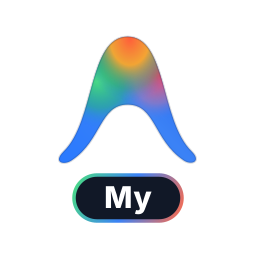

<div align="center">
  
  <h1>My Antigravity (<code>my_antigravity</code>)</h1>
  <p>Modular desktop UX &amp; UI plugin loader and enhancement suite for the <strong>Antigravity</strong> Electron desktop app.</p>
  <p><a href="README.md">简体中文</a> | <strong>English</strong></p>
</div>

---

## Overview

**My Antigravity** injects a lightweight, zero-dependency renderer loader into Antigravity's `app.asar` once, and loads modular UI/UX plugins dynamically from `~/.gemini/config/plugins/my_antigravity/desktop-mods/`.

- **Zero external npm dependencies** — built with pure Node.js (ASAR parser + SHA-256 integrity recalculation + IPC bridge).
- **Non-destructive & reversible** — backs up original `app.asar` to `app.asar.my_antigravity.bak` and supports clean one-click uninstall.
- **Independent plugin toggles** — enable or disable individual mods directly inside the app via `mod-manager`, without overwriting preferences on `npm run sync`.

---

## Included Plugins

| Plugin | Description |
| :--- | :--- |
| **`enter-newline`** | Swaps chat input shortcuts in the Lexical editor to **`Enter` for newline** and **`Shift+Enter` to send**, while preserving IME composition, `@` / `/` typeahead selection, modifier combos (`Ctrl`/`Cmd`/`Alt+Enter`), and repeat-send protection. |
| **`zh-cn`** | Simplified Chinese localization for Antigravity's desktop UI (top menus, sidebar, settings, shortcuts, Customizations, chat frame & side panels). Strictly isolates user messages, AI responses, code blocks, terminals, icon fonts, and URLs so conversation content is never altered. |
| **`session-status`** | Compact status bar under the chat composer showing **Turns / Steps / Latest TPS**, **Total Tokens & Cache Hit Rate** (plus optional estimated API cost when server cost summary is enabled), and **Context Window Usage** ring with category breakdown. Collapsible into a mini footer ring. |
| **`model-enhancer`** | Replaces the model picker with a two-stage **Codex-style thinking-effort slider** (smooth click/drag, keyboard navigation, reset-to-default `↺`, and `groupedModels` compatibility) and a **brand-icon model list** (covering Gemini 4 & `Orchestrator`/planner submenu rows, Claude, GPT/OpenAI, DeepSeek, Grok, Qwen, Kimi, GLM/Zhipu, MiniMax, Hunyuan, MiMo, Muse, etc.) with smooth transitions and `Esc` back-navigation. See [`plugins/model-enhancer/README.md`](plugins/model-enhancer/README.md) for icon customization and maintenance. |
| **`quota-rings`** | Displays two neutral `22×22px` quota rings beside the bottom-left Settings button: **Other Built-in Models** (rounded square) and **Gemini** (circle). Supports 1:3 dual-window split (5h + weekly) with automatic single-window fallback, hover reset-time tooltips, and click-to-open Model Quota settings. |
| **`file-link-color`** | Pure CSS plugin that highlights filenames (including extensions) of chat file links with file icons (including generic `document.svg`, excluding folders) in native link blue, adapting automatically to light/dark themes while preserving muted line-number suffixes (`#L...`) and file tree styling. |
| **`taskbar-badge`** | **(Testing / Experimental)** Unread background session indicator: when unfocused or background conversations finish, request approval, or error, displays a deduplicated session count on the Windows taskbar via multi-DPI `setOverlayIcon` (**`error >> approval >> completed`**, colored red / yellow / dark charcoal, `99+` cap) and a matching green / yellow / red dot on the system tray icon. Clicking each conversation decrements the count back to zero. *(Limited by Windows' native `16×16 DIP` overlay slot clarity; requires re-running `install-loader` once for the main-process bridge.)* |
| **`dino-game`** | Right auxiliary pane mini-game: adds a compact Dino button to the top-right toolbar of the right aux pane (no left sidebar entry) that opens a borderless Chrome Dino game blending into the native pane background; supports `Space` / `↑` jump, `↓` duck/fast-drop, `P` pause, `Esc` close, light/dark theme adaptation, and strict focus isolation from the main chat input. |
| **`mod-manager`** | Maps the top-left Antigravity logo button to a **Plugin Manager** popover (`Alt + Click` preserves the original home action). Lists mods with persistent switches (`mods-state.json`) and one-click window reload when changes are pending. Includes the current suite version and an on-demand **Check Updates** button in the top-right header (no background polling): prompts when up to date, or shows the newer version and switches the button to `GitHub ↗` to open the repository in the default browser. |

---

## Installation & Usage

### Prerequisites
- **Node.js** (v18+ recommended)
- **Antigravity Desktop** (Electron app)

### Install Loader & Sync Plugins
1. **Completely quit Antigravity** (including the system tray icon) so `app.asar` is not locked.
2. Run in the repository root:
   ```bash
   npm run install-loader
   ```
   Or on Windows, double-click [`install.cmd`](install.cmd).

> **Windows Encoding Tip**: If `.cmd` script output shows garbled characters on Windows, switch your Windows system locale to UTF-8 (*Region settings → Administrative → Change system locale → Beta: Use Unicode UTF-8 for worldwide language support*), or run `npm run install-loader` directly in a terminal.

### Common Commands
```bash
npm test                  # Run all unit tests (node --test)
npm run build             # Bundle multi-file plugins into standalone index.js files
npm run sync              # Build and sync plugins to ~/.gemini/config/plugins/my_antigravity/
npm run status            # Inspect loader status and active plugin states
npm run uninstall-loader  # Restore original app.asar (or double-click uninstall.cmd on Windows)
```

> **Note**:
> - For regular edits under `plugins/`, run `npm run sync` and reload the window without reinstalling the loader; if changes touch `loader/` (e.g., new main-process IPC bridges), quit Antigravity completely and run `npm run install-loader` once.
> - When Antigravity auto-updates and replaces `app.asar`, simply quit Antigravity and re-run `npm run install-loader` (or `install.cmd`). Your `mods-state.json` toggle preferences will be preserved.

---

## Project Structure

```text
my_antigravity/
├── assets/logo.svg         # Plugin suite icon
├── loader/                 # Zero-dependency Electron ASAR loader & CLI
│   ├── asar.mjs            # ASAR reader/writer & SHA-256 integrity recalculation
│   ├── main-hook.js        # Main-process IPC & mods-state.json persistence
│   ├── preload-hook.js     # Preload bridge & main-world JS/CSS injector
│   └── cli.mjs             # CLI (sync / install / uninstall / status)
├── plugins/                # Modular desktop plugins (one directory per plugin)
│   ├── dino-game/
│   ├── enter-newline/
│   ├── file-link-color/
│   ├── mod-manager/
│   ├── model-enhancer/
│   ├── quota-rings/
│   ├── session-status/
│   ├── taskbar-badge/
│   └── zh-cn/
├── test/                   # Unit tests (node --test)
├── install.cmd             # Windows one-click installer
├── uninstall.cmd           # Windows one-click uninstaller
└── package.json
```

---

## Third-Party Notices

Third-party icon assets and their licenses used in `model-enhancer` are documented in [`plugins/model-enhancer/THIRD_PARTY_NOTICES.md`](plugins/model-enhancer/THIRD_PARTY_NOTICES.md).
