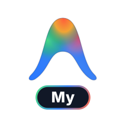

<div align="center">
  
  <h1>My Antigravity (<code>my_antigravity</code>)</h1>
  <p>面向 <strong>Antigravity 桌面版（Electron）</strong> 的模块化插件加载器与 UI/UX 增强套件。</p>
  <p><strong>简体中文</strong> | <a href="README.en.md">English</a></p>
</div>

---

## 简介

**My Antigravity** 采用「一次挂载渲染层加载器 + 外部插件目录动态读取」方案：仅在 `app.asar` 注入一次极简加载器，后续所有小插件均在仓库内开发并同步至 `~/.gemini/config/plugins/my_antigravity/desktop-mods/`，重启窗口即可生效。

- **零外部 npm 依赖**：加载器与构建脚本完全基于原生 Node.js（含 ASAR 读写与 SHA-256 完整性校验重算）。
- **无损备份与一键还原**：安装时自动备份原始 `app.asar` 为 `app.asar.my_antigravity.bak`，卸载即可完整恢复。
- **独立开关持久化**：通过内置 `mod-manager` 在界面内独立开关各个小插件，状态保存于 `mods-state.json`，不会因 `npm run sync` 被覆盖。

---

## 当前已有功能

| 插件 | 功能说明 |
| :--- | :--- |
| **`enter-newline`** | 将聊天输入框（Lexical 编辑器）默认快捷键反转为 **`Enter` 换行、`Shift+Enter` 发送**；自动放行输入法选词（IME）、`@` 提及与 `/` 斜杠补全菜单、`Ctrl`/`Cmd`/`Alt+Enter` 组合键，并防止按住 `Shift+Enter` 连发重复提交。 |
| **`zh-cn`** | Antigravity 桌面版界面简体中文化，覆盖顶部菜单栏、侧边栏、设置页、快捷键、Customizations 与聊天外框/辅助面板（保留 `Antigravity`、`MCP`、`Skills`、`Rules`、`Hooks` 等技术专有名词）；严格隔离用户消息、AI 回复、代码块、终端、图标字体与 URL，绝不误翻对话与代码。 |
| **`session-status`** | 在聊天输入框下方展示实时会话状态栏：**回合 / 模型步数 / 最近 TPS**（悬停或点击可看平均 TTFT、近 10 轮平均 TPS 与当前模型）、**Token 累计用量与缓存命中率**（含思考/正文/未缓存输入/缓存读取构成，开启 `enable-cost-accumulator` 时显示预估费用）、**上下文窗口占用环**（含系统与工具/对话消息/子智能体分类及压缩次数）；支持收起为底部迷你小环。 |
| **`model-enhancer`** | 将模型选择弹窗改造为两段式面板：**Stage 1** 提供 Codex 风格的思考深度胶囊拉条（支持点击平滑滑动、连续跟手拖动、键盘方向键调节及一键恢复默认 `↺`，兼容新版 `groupedModels` 结构）；**Stage 2** 为模型列表注入品牌 SVG 图标（支持 Gemini 4 系列、`Orchestrator` 协调器及其规划器子菜单、Claude、GPT/OpenAI、DeepSeek、Grok、Qwen、Kimi、GLM/智谱、MiniMax、Hunyuan、MiMo、Muse 等），支持平滑过渡动画与 `Esc` 逐级返回。图标自定义与增删维护详见 [`plugins/model-enhancer/README.md`](plugins/model-enhancer/README.md)。 |
| **`quota-rings`** | 在左下角「设置」按钮右侧并排展示两个 `22×22px` 中性灰额度环：**左侧圆角方形**汇总其它内置模型（排除禁用与 BYOK 自定义模型），**右侧圆形**展示 Gemini 额度；支持 5h + 周窗 1:3 双段分割（无周窗数据时自动降级为单环），悬停显示重置时间（`MM/DD HH:mm`）与子池明细，点击直达「设置 → 模型」。 |
| **`file-link-color`** | 纯 CSS 插件：将聊天正文中带有文件图标（含专属图标与普通文档 `document.svg`，排除文件夹）的文件链接名称及后缀高亮为 Antigravity 原生链接蓝，自动适配明暗主题，并保留行号锚点（`#L...`）原灰色与侧边栏文件树原貌。 |
| **`taskbar-badge`** | **（测试阶段）** 后台会话状态角标插件：当非当前聚焦会话发生**报错 / 提问审批 / 任务完成**时，按 **`报错 >> 提问 >> 完成`** 优先级在 Windows 任务栏通过多 DPI `setOverlayIcon` 显示去重会话计数（红 / 黄 / 深灰，超过 99 显示 `99+`），并在右下角系统托盘右上角同步显示绿 / 黄 / 红圆点，点开对应会话后计数自动 `-1` 直至归零。*(受 Windows 原生 `16×16 DIP` Overlay 槽位限制，小屏或低缩放下数字清晰度有限；需重跑一次 `install-loader` 以接入主进程桥接。)* |
| **`dino-game`** | 右侧辅助面板趣味小游戏：仅在右侧辅助面板右上角控制栏挂载小恐龙快捷按钮，点击原地展开无边框、继承原生面板背景色的谷歌小恐龙（Chrome Dino）小游戏；支持 `Space` / `↑` 跳跃、`↓` 下蹲/速降、`P` 键暂停与 `Esc` 关闭，明暗主题自适应且不抢占主聊天框输入。 |
| **`mod-manager`** | 将左上角 Antigravity 图标按钮映射为插件管理菜单（按住 `Alt + 左键` 保留原生回首页功能）；支持在界面内单独开关各小插件，存在待生效变更时在底部提示并提供一键重载窗口。菜单右上角附带当前总版本号与主动「检查更新」按钮（不进行被动后台推送）：无更新时提示「当前版本已是最新」，发现新版本时展示新版本号并将按钮切换为 `GitHub ↗` 以在默认浏览器打开项目主页。 |

---

## 安装与使用

### 环境要求
- **Node.js**（建议 v18+）
- **Antigravity Desktop** 桌面端

### 安装加载器并同步插件
1. **完全退出 Antigravity 桌面版**（包括系统托盘图标），避免 `app.asar` 被占用锁定。
2. 在仓库根目录运行：
   ```bash
   npm run install-loader
   ```
   Windows 用户也可直接双击根目录下的 [`install.cmd`](install.cmd)。

> **Windows 安装提示**：如果运行 `.cmd` 安装脚本时出现中文乱码，需要将 Windows 系统区域设置切换为 UTF-8（在系统设置中勾选「Beta 版：使用 Unicode UTF-8 提供全球语言支持」），或直接使用 `npm run install-loader` 命令安装。

### 常用维护命令
```bash
npm test                  # 运行全部单元测试 (node --test)
npm run build             # 将多文件源码插件打包为单文件 index.js
npm run sync              # 构建并同步插件到 ~/.gemini/config/plugins/my_antigravity/
npm run status            # 查看加载器状态与各小插件开关状态
npm run uninstall-loader  # 卸载加载器并恢复原始 app.asar（Windows 也可双击 uninstall.cmd）
```

> **提示**：
> - 日常仅修改 `plugins/` 下的小插件时，运行 `npm run sync` 并重启 Antigravity 窗口即可，无需重装加载器；若更新涉及 `loader/`（如新增主进程 IPC 桥接），需完全退出客户端后运行一次 `npm run install-loader`。
> - 当 Antigravity 官方自动升级覆盖 `app.asar` 后，完全退出客户端并重新运行一次 `install.cmd`（或 `npm run install-loader`）即可恢复；`mods-state.json` 中的开关偏好会自动保留。

---

## 目录结构

```text
my_antigravity/
├── assets/logo.svg         # 插件组图标
├── loader/                 # 零依赖 Electron 加载器与 CLI
│   ├── asar.mjs            # ASAR 读写与 SHA-256 integrity 重算
│   ├── main-hook.js        # 主进程 IPC 服务与 mods-state.json 持久化
│   ├── preload-hook.js     # 预加载钩子与主世界 JS/CSS 注入
│   └── cli.mjs             # 管理 CLI（sync / install / uninstall / status）
├── plugins/                # 模块化小插件源码（一个插件一个子目录）
│   ├── dino-game/
│   ├── enter-newline/
│   ├── file-link-color/
│   ├── mod-manager/
│   ├── model-enhancer/
│   ├── quota-rings/
│   ├── session-status/
│   ├── taskbar-badge/
│   └── zh-cn/
├── test/                   # 自动化单元测试
├── install.cmd             # Windows 一键安装脚本
├── uninstall.cmd           # Windows 一键卸载脚本
└── package.json
```

---

## 第三方许可声明

`model-enhancer` 所使用的第三方图标资源及开源许可详见 [`plugins/model-enhancer/THIRD_PARTY_NOTICES.md`](plugins/model-enhancer/THIRD_PARTY_NOTICES.md)。
